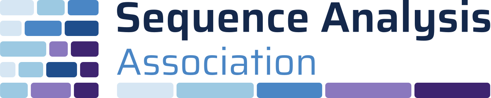
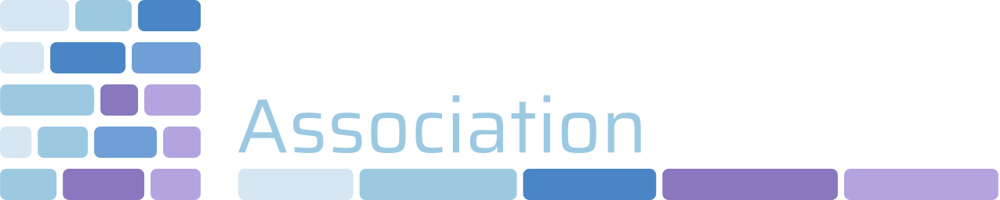
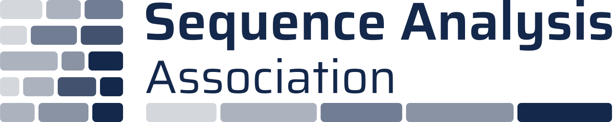
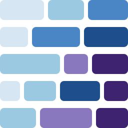
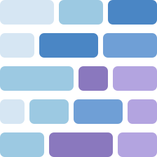
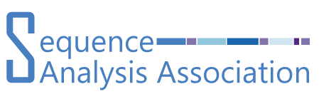

::: {.seq-strip}
:::

The look of this website is defined in a single [brand.yml](https://quarto.org/docs/authoring/brand.html) file (`_brand.yml`, plus `_brand-dark.yml` for dark mode). Quarto reads the same file for HTML, revealjs slides, Typst/PDF documents and dashboards, so presentations and reports can share the SAA identity without extra styling work.

## The logo

The signet is a stylised **sequence index plot**: five sequences of coloured episodes (states). In the horizontal logo the bottom sequence continues underneath the wordmark as a timeline. The wordmark is set in Saira (SemiBold for “Sequence Analysis”, Regular for “Association”); all logo files have their text converted to outlines.

::: {.grid}
::: {.g-col-12 .g-col-md-6}
::: {.logo-stage .on-light}
{fig-alt="SAA logo, horizontal, for light backgrounds" width="340"}
:::
`saa-logo.svg` — primary logo, light backgrounds
:::
::: {.g-col-12 .g-col-md-6}
::: {.logo-stage .on-dark}
{fig-alt="SAA logo, horizontal, for dark backgrounds" width="340"}
:::
`saa-logo-dark.svg` — navy or darker backgrounds
:::
::: {.g-col-12 .g-col-md-6}
::: {.logo-stage .on-light}
{fig-alt="SAA logo in a single navy colour" width="340"}
:::
`saa-logo-mono-navy.svg` — single colour, print and b/w
:::
::: {.g-col-12 .g-col-md-6}
::: {.logo-stage .on-blue}
{fig-alt="SAA logo in white on a blue background" width="340"}
:::
`saa-logo-mono-white.svg` — photos and saturated colours
:::
::: {.g-col-4}
::: {.logo-stage .on-light}
{fig-alt="SAA signet" width="96"}
:::
`saa-signet.svg`
:::
::: {.g-col-4}
::: {.logo-stage .on-dark}
{fig-alt="SAA signet on a dark background" width="96"}
:::
`saa-signet-dark.svg`
:::
::: {.g-col-4}
::: {.logo-stage .on-light}
{fig-alt="SAA favicon" width="48"}
:::
`favicon.svg` — below 32 px
:::
:::

### Usage rules

::: {.icon-list}
- []{.bi .bi-bounding-box} **Clear space:** at least the height of two signet rows (≈ ⅓ of the logo height) on all sides.
- []{.bi .bi-arrows-angle-contract} **Minimum size:** horizontal logo ≥ 120 px wide on screen (≈ 30 mm in print); smaller than that, use the signet alone, and below 32 px the favicon.
- []{.bi .bi-circle-half} Use the dark version on navy or darker backgrounds and the white version on photos or saturated colours — never the colour logo on mid-tone backgrounds.
- []{.bi .bi-slash-circle} Do not recolour, stretch or re-arrange the bars, add effects, or re-set the wordmark in another font.
:::

## Colours

The six state colours of the signet (sky-50 → sky-200 → blue-500 → violet-400 → blue-700 → violet-800) double as a categorical palette for figures.

::: {.swatches}
::: {.swatch}
::: {.chip style="background:#0F1F3A"}
:::
::: {}
**navy-950** · dark backgrounds<br>`#0F1F3A`
:::
:::
::: {.swatch}
::: {.chip style="background:#14284B"}
:::
::: {}
**navy-900** · text, headings<br>`#14284B`
:::
:::
::: {.swatch}
::: {.chip style="background:#1F4E8C"}
:::
::: {}
**blue-700** · primary, links<br>`#1F4E8C`
:::
:::
::: {.swatch}
::: {.chip style="background:#4A86C5"}
:::
::: {}
**blue-500** · accents<br>`#4A86C5`
:::
:::
::: {.swatch}
::: {.chip style="background:#9CC9E2"}
:::
::: {}
**sky-200** · light accent<br>`#9CC9E2`
:::
:::
::: {.swatch}
::: {.chip style="background:#D6E6F3"}
:::
::: {}
**sky-50** · tints<br>`#D6E6F3`
:::
:::
::: {.swatch}
::: {.chip style="background:#8A78BE"}
:::
::: {}
**violet-400** · secondary<br>`#8A78BE`
:::
:::
::: {.swatch}
::: {.chip style="background:#3E2470"}
:::
::: {}
**violet-800** · deepest state<br>`#3E2470`
:::
:::
::: {.swatch}
::: {.chip style="background:#5A6478"}
:::
::: {}
**gray-600** · muted text<br>`#5A6478`
:::
:::
::: {.swatch}
::: {.chip style="background:#F3F5F9"}
:::
::: {}
**gray-50** · surfaces<br>`#F3F5F9`
:::
:::
:::

Blue-700 is used for links and buttons (8.3 : 1 contrast on white). Blue-500 is for accents and large text only (3.8 : 1); on dark backgrounds sky-200, blue-400 and violet-300 replace the darker tones.

## Typography

| Role | Typeface | Sample |
|------|----------|--------|
| Logo, headings, navigation | [Saira](https://fonts.google.com/specimen/Saira) 400 / 600 | [Sequence Analysis Association]{style="font-family:Saira;font-weight:600;font-size:1.35rem"} |
| Body text | [Noto Sans](https://fonts.google.com/specimen/Noto+Sans) 400 / 600 / 700 | [Trajectories, transitions and turning points.]{style="font-family:'Noto Sans'"} |
| Code | [Fira Code](https://fonts.google.com/specimen/Fira+Code) 400 / 500 | `seqdef(data, var = 1:12)` |

All three are Google Fonts under the SIL Open Font License. Fira Code ligatures (`<-`, `|>`, `!=` …) are switched on in code blocks and off in inline code, so running text shows exactly what readers have to type:

```r
seq <- seqdef(biofam, var = 10:25) |> seqdist(method = "OM", sm = "TRATE")
```

## Using the brand elsewhere

Copy `_brand.yml` together with the `logos/` and `favicons/` folders into any Quarto project and it is picked up automatically:

```yaml
# slides.qmd
format: revealjs   # or typst, pdf, dashboard ...
brand: _brand.yml
```

::: {.callout-note appearance="simple" collapse="true"}
## Previous logo (2018)
::: {.logo-stage .on-light}
{fig-alt="The original SAA logo from 2018" width="300"}
:::
:::
