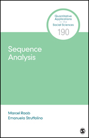
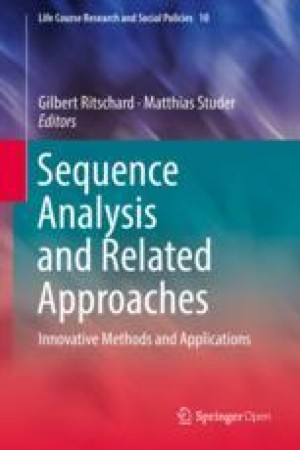
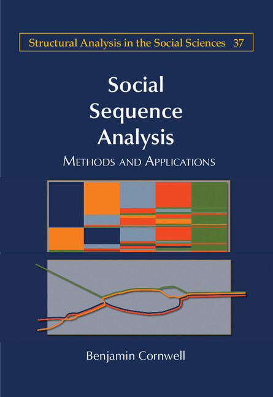
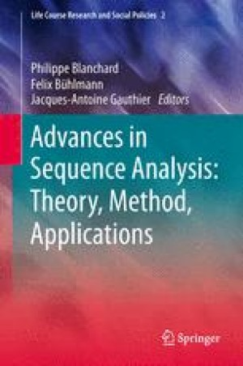

::: {.seq-strip}
:::

## Overview

Key books and articles from the SAA community — a good place to start reading about sequence analysis.

```{=html}
<ol class="timeline">

  <li class="tl-item">
    <div class="tl-year">2022</div>
    <article class="tl-card">
      
      <div class="tl-body">
        <p class="tl-kind"><span>Journal article</span><span class="tl-oa">Open access</span><span class="tl-saa">Joint paper by SAA members</span></p>
        <h3 class="tl-title">Sequence analysis: Its past, present, and future</h3>
        <p class="tl-ref">Liao, T. F., Bolano, D., Brzinsky-Fay, C., Cornwell, B., Fasang, A. E., Helske, S., Piccarreta, R., Raab, M., Ritschard, G., Struffolino, E., &amp; Studer, M. (2022). <em>Social Science Research</em>, 107, 102772.</p>
        <p class="tl-lead">Written for the journal’s 50th anniversary, the article looks back on four decades of sequence analysis in the social sciences and sketches where the method is heading.</p>
        <details>
          <summary>More about this article</summary>
          <p>Using the life course as an analogy, the authors trace the “birth” of sequence analysis in Andrew Abbott’s work, its first and second waves, and its future maturity. They review methodological developments — visualisation, complexity and dissimilarity measures, cluster analysis, multichannel, dyadic and Markov-chain-based approaches, sequence network analysis and software — and discuss open challenges, including how sequence analysis can inform theory-building.</p>
        </details>
        <p class="tl-links"><a href="https://doi.org/10.1016/j.ssresearch.2022.102772">DOI 10.1016/j.ssresearch.2022.102772</a></p>
      </div>
    </article>
  </li>

  <li class="tl-item tl-same-year">
    <div class="tl-year">2022</div>
    <article class="tl-card">
      
      <div class="tl-body">
        <p class="tl-kind"><span>Book</span></p>
        <h3 class="tl-title">Sequence Analysis</h3>
        <p class="tl-ref">Raab, M., &amp; Struffolino, E. (2022). Quantitative Applications in the Social Sciences, Vol. 190. Thousand Oaks, CA: SAGE.</p>
        <p class="tl-lead">A concise, hands-on introduction for social scientists — from defining and visualising sequences to comparing and clustering them.</p>
        <details>
          <summary>More about this book</summary>
          <p>The “little green book” guides readers through the typical workflow of a sequence analysis, including dissimilarity measures, cluster analysis and multichannel sequence analysis. A companion website provides data and R code for all chapters (TraMineR, TraMineRextras, WeightedCluster), plus bonus material on ggseqplot and the Python package Sequenzo.</p>
        </details>
        <p class="tl-links"><a href="https://uk.sagepub.com/en-gb/eur/sequence-analysis/book272086">Publisher</a> · <a href="https://sa-book.github.io/">Companion website</a></p>
      </div>
    </article>
  </li>

  <li class="tl-item">
    <div class="tl-year">2018</div>
    <article class="tl-card">
      
      <div class="tl-body">
        <p class="tl-kind"><span>Edited volume</span><span class="tl-oa">Open access</span></p>
        <h3 class="tl-title">Sequence Analysis and Related Approaches: Innovative Methods and Applications</h3>
        <p class="tl-ref">Ritschard, G., &amp; Studer, M. (Eds.) (2018). Life Course Research and Social Policies, Vol. 10. Cham: Springer.</p>
        <p class="tl-lead">How sequence analysis can be combined with other longitudinal methods such as event history analysis, Markov models and sequence networks.</p>
        <details>
          <summary>More about this book</summary>
          <p>Methodological chapters propose, among others, measures of the precarity of work trajectories, Markov-based as well as fuzzy and monothetic clustering of sequences, network-based sequence analysis, and the joint use of sequence analysis with hidden Markov and survival models. Applications range from gendered occupational careers in Germany to the daily schedules of dual-earner couples in Italy.</p>
        </details>
        <p class="tl-links"><a href="https://doi.org/10.1007/978-3-319-95420-2">DOI 10.1007/978-3-319-95420-2</a></p>
      </div>
    </article>
  </li>

  <li class="tl-item">
    <div class="tl-year">2015</div>
    <article class="tl-card">
      
      <div class="tl-body">
        <p class="tl-kind"><span>Book</span></p>
        <h3 class="tl-title">Social Sequence Analysis: Methods and Applications</h3>
        <p class="tl-ref">Cornwell, B. (2015). Structural Analysis in the Social Sciences, Vol. 37. Cambridge: Cambridge University Press.</p>
        <p class="tl-lead">A monograph covering the theoretical foundations, core concepts and techniques of sequence analysis in the social sciences.</p>
        <details>
          <summary>More about this book</summary>
          <p>After setting out the theoretical background, the book moves from sequence concepts and data through methods for detecting sequence structure and whole-sequence comparison to new directions such as network methods for sequence analysis.</p>
        </details>
        <p class="tl-links"><a href="https://doi.org/10.1017/CBO9781316212530">DOI 10.1017/CBO9781316212530</a></p>
      </div>
    </article>
  </li>

  <li class="tl-item">
    <div class="tl-year">2014</div>
    <article class="tl-card">
      
      <div class="tl-body">
        <p class="tl-kind"><span>Edited volume</span></p>
        <h3 class="tl-title">Advances in Sequence Analysis: Theory, Method, Applications</h3>
        <p class="tl-ref">Blanchard, Ph., Bühlmann, F., &amp; Gauthier, J.-A. (Eds.) (2014). Life Course Research and Social Policies, Vol. 2. Cham: Springer.</p>
        <p class="tl-lead">Brings together traditions of sequence analysis that developed separately, with contributions on life courses, careers and political trajectories.</p>
        <details>
          <summary>More about this book</summary>
          <p>Methodological chapters cover sequential concepts and coding, atypical data and time patterns, optimal matching and alternative algorithms, survey optimisation and visualisation. Field studies range from parenting in 19th-century Belgium and family formation around German reunification to long-term trends in electoral participation and regime democratisation.</p>
        </details>
        <p class="tl-links"><a href="https://doi.org/10.1007/978-3-319-04969-4">DOI 10.1007/978-3-319-04969-4</a></p>
      </div>
    </article>
  </li>

</ol>
```

Know of a book or article that should be listed here? Let us know at [info@sequenceanalysis.org](mailto:info@sequenceanalysis.org).

## Bibliography & Wikipedia

::: {.link-cards}
::: {.link-card}
[Z]{.badge-icon .zotero}

::: {}
[SAA Zotero bibliography](https://www.zotero.org/groups/2268769/saa_bibliography/items/){.stretched-link}

Open group library of books, journal articles and other publications on sequence analysis and related methods.
:::
:::

::: {.link-card}
[]{.bi .bi-wikipedia}

::: {}
[Wikipedia: Sequence analysis in social sciences](https://en.wikipedia.org/wiki/Sequence_analysis_in_social_sciences){.stretched-link}

A general introduction to the method, its history and main tools.
:::
:::
:::

Missing a reference? Send it to [info@sequenceanalysis.org](mailto:info@sequenceanalysis.org) and we will add it to the library.

## Software

::: {.software}

### {.sw-logo} R packages

| Package | What it does | Links |
|---------|--------------|-------|
| **TraMineR** | Trajectory Miner in R: toolkit for exploring, analysing and rendering state and event sequences. | [Website](http://traminer.unige.ch/) · [CRAN](https://cran.r-project.org/package=TraMineR) · [JSS](https://doi.org/10.18637/jss.v040.i04) |
| **TraMineRextras** | Ancillary functions and utilities to be used with TraMineR. | [CRAN](https://cran.r-project.org/package=TraMineRextras) |
| **WeightedCluster** | Clustering of state sequences and weighted data: optimised weighted PAM, cluster quality measures, tree plots. | [Website](http://mephisto.unige.ch/weightedcluster/) · [CRAN](https://cran.r-project.org/package=WeightedCluster) |
| **seqhandbook** | Episodes in individual sequences, association between domains, smoothing for index plots, heat maps, GIMSA and more. | [CRAN](https://cran.r-project.org/package=seqhandbook) |
| **ggseqplot** | ggplot2-based versions of the TraMineR sequence plots. | [Website](https://maraab23.github.io/ggseqplot/) · [CRAN](https://cran.r-project.org/package=ggseqplot) |
| **seqimpute** | Multiple imputation of missing data in sequences via random forest or multinomial regression. | [CRAN](https://cran.r-project.org/package=seqimpute) |
| **PST** | Probabilistic suffix trees and variable-length Markov chains for categorical sequences. | [CRAN](https://cran.r-project.org/package=PST) · [JSS](https://doi.org/10.18637/jss.v072.i03) |
| **march** | Markovian models for categorical data: homogeneous Markov chains, MTD, HMM, DCMM. | [CRAN](https://cran.r-project.org/package=march) · [MARCH](https://andreberchtold.com/march.html) |
| **seqHMM** | (Mixture) hidden Markov models for (multichannel) social sequences. | [CRAN](https://cran.r-project.org/package=seqHMM) · [JSS](https://doi.org/10.18637/jss.v088.i03) |
| **MCseqReplic** | Monte Carlo simulations of the impact of timing errors on SA outcomes. | [CRAN](https://cran.r-project.org/package=MCseqReplic) |
| **MEDseq** | Model-based clustering of life-course sequences with mixtures of exponential-distance models. | [CRAN](https://cran.r-project.org/package=MEDseq) · [Paper](https://doi.org/10.1111/rssa.12712) |
| **ctsfeatures** | Entropy and serial-dependence measures for categorical time series, with graphics. | [CRAN](https://cran.r-project.org/package=ctsfeatures) · [Paper](https://doi.org/10.1016/j.jocs.2024.102233) |

: {tbl-colwidths="[18,62,20]"}

### {.sw-logo} Stata packages

| Package | What it does | Links |
|---------|--------------|-------|
| **SQ** | Stata module for sequence analysis. | [Stata Journal](https://www.stata-journal.com/article.html?article=st0111) · [EconPapers](https://econpapers.repec.org/software/bocbocode/s456755.htm) |
| **SADI** | Sequence analysis tools for Stata. | [Stata Journal](https://journals.sagepub.com/doi/pdf/10.1177/1536867X1701700302) |
| **MICT** | Multiple imputation for categorical time series. | [Stata Journal](https://journals.sagepub.com/doi/10.1177/1536867X1601600303) |

: {tbl-colwidths="[18,62,20]"}

### {.sw-logo} Python

| Package | What it does | Links |
|---------|--------------|-------|
| **Sequenzo** | Sequence analysis toolkit for Python. | [Website](https://sequenzo.yuqi-liang.tech/en/) |

: {tbl-colwidths="[18,62,20]"}

:::
::: {.callout-tip}
## Know a package we are missing?
Let us know at [info@sequenceanalysis.org](mailto:info@sequenceanalysis.org) — we will add it here and announce it on the blog.
:::
